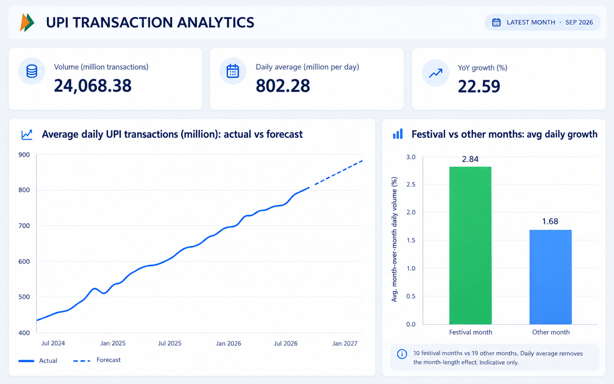
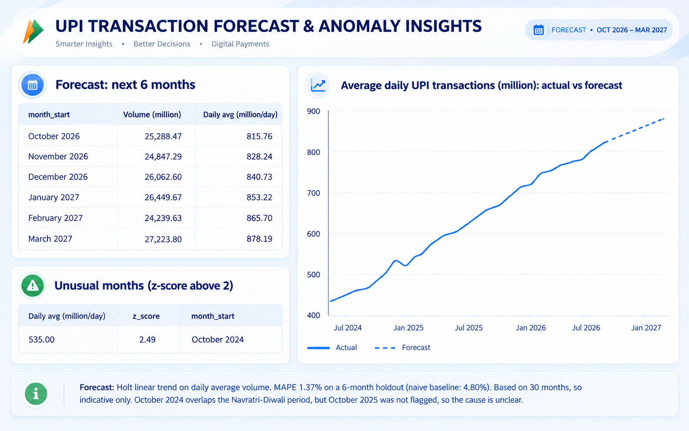

# UPI Digital Payments Analytics (India)

End-to-end analysis of India's monthly UPI transactions (Apr 2024 to Sep 2026): data cleaning, a MySQL star schema, growth and festival analysis, a 6-month forecast, anomaly detection, and a Power BI dashboard.

## Business questions
1. How fast is UPI growing month over month and year over year?
2. Do festival months show faster growth?
3. What will UPI volume look like over the next 6 months?
4. Are there unusual months in the data?

## Data
- **Source:** NPCI UPI Product Statistics (monthly national totals: banks live, volume in millions, value in crores), financial years 2024-25, 2025-26 and 2026-27.
- **Festival table:** `data/reference/festivals.csv`, built by me. A month is marked as a festival month if it contains a major national festival.
- The raw NPCI files are not in this repo. Download them from the NPCI website (Statistics > Product Statistics) into `data/raw/`.

## Tools
Python (pandas, SQLAlchemy, statsmodels, matplotlib), MySQL 8, Power BI Desktop

## Method
1. **Cleaning (Python):** converted text months to dates, removed commas from numbers, fixed a misplaced-comma typo in one value, combined three yearly files, and checked for duplicate and missing months (30 months, none missing).
2. **Warehouse (MySQL):** star schema with `dim_date` and `fact_upi_monthly`, loaded with SQLAlchemy.
3. **Analysis (SQL and pandas):** month-over-month and year-over-year growth with window functions, using daily averages to remove month-length effects. SQL and pandas results match.
4. **Forecast:** Holt linear trend model on daily average volume, tested on the last 6 months.
5. **Anomalies:** z-score on the model residuals.
6. **Dashboard:** two Power BI pages (overview, forecast and unusual months).

## Key findings
- **Strong growth:** daily UPI transactions rose from about 443 million (Apr 2024) to about 802 million (Sep 2026), roughly +81%. Year-over-year volume growth in Sep 2026 was about 22.6%.
- **February dips are a calendar effect:** monthly totals dip in February, but daily averages keep rising. February has fewer days.
- **Festival months grew faster:** average month-over-month growth in daily volume was 2.84% in festival months vs 1.68% in other months. Raw monthly totals would have shown a much larger gap (4.72% vs 0.85%), but most of that came from month lengths, so I used daily averages.
- **Forecast:** MAPE of 1.37% on a 6-month holdout, against 4.80% for a naive "repeat the last value" baseline. The model projects about 27,200 million transactions for March 2027.
- **One unusual month:** October 2024 (z-score 2.49). It overlaps the Navratri-Diwali period, but October 2025 was not flagged, so the cause is unclear.

## Limitations
- Only **30 months** of data, so yearly seasonality can't be modelled and the festival result is an indication, not proof (10 festival months vs 19 others).
- The forecast follows the trend only. It cannot predict festival spikes.
- Data is **national totals only**. Bank-wise market share and decline-rate analysis were not done.
- Festival months were marked by me from the festival calendar and are an approximation.
- The dashboard reads exported CSV files. It is not connected live to MySQL.

## Dashboard



## Project structure
```
data/cleaned/      cleaned and exported data
data/reference/    festival table
notebooks/         exploration and analysis
sql/               table creation and analysis queries
dashboard/         Power BI file and screenshots
```

## How to run
1. Install Python 3.10+ and MySQL 8+.
2. `pip install -r requirements.txt`
3. Download the NPCI files into `data/raw/`.
4. Create a `.env` file with `DB_PASSWORD=your_mysql_password`.
5. Run `sql/01_create_tables.sql` in MySQL, then the notebook, then `sql/02_analysis.sql`.